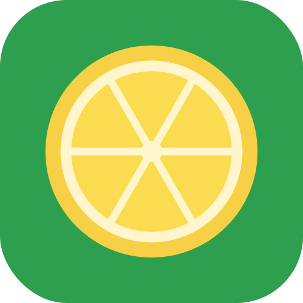

<p align="center">
  
</p>

<h1 align="center">Zeste</h1>

Zeste is a fork of [Azahar](https://github.com/azahar-emu/azahar) that I use to test 3DS
homebrew. Azahar is very forgiving, so things that crash or break on a real New 3DS often
work fine in it. Zeste tries to catch those cases. Warning it's vibecoded but is VERY useful for my 3DS ports.

When enabled (everything is off by default), it can:

- turn bad memory accesses and stack overflows into real crashes / exception handler calls
- warn about GPU stuff the real PICA200 doesn't like (near-plane triangles, broken textures,
  buffers it can't reach)
- warn when the CPU cache wasn't flushed before the GPU or DSP reads something
- use a memory layout closer to the real 178 MB mode
- shake up thread scheduling to make races show up (with a seed, so they can be replayed)
- slow down the SD card, GPU and CPU to roughly hardware speed
- run with no window (`--headless`) and be driven by a script or over RPC: inputs,
  screenshots, memory and GPU command dumps, HOME / sleep / close
- boot a `.cia` straight from the command line

Settings are under Zeste > Hardware accuracy settings, or `--strict` on the command line
to turn everything on. `zeste.exe --help` lists the options.

## Building (Windows)

Needs Visual Studio 2022 (or the Build Tools) with the C++ workload.

```
git clone --recursive <this repo>
cd Zeste
tools\zeste\build_windows.cmd configure
```

The exe ends up in `build\bin\Release\zeste.exe`. After the first time, just run
`tools\zeste\build_windows.cmd`.

Only the Windows build is maintained here. The other platforms are untouched from Azahar
and may or may not build.

## Credits

All the actual emulator work is from the Azahar and Citra developers. Zeste just adds a
testing layer on top. Same license as Azahar (GPLv2 or later, see `license.txt`).

Not affiliated with Nintendo.
