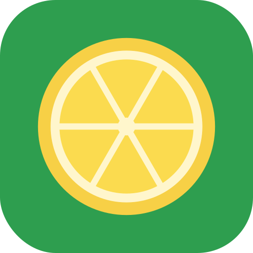

<p align="center">
  
</p>

<h1 align="center">Zeste</h1>

> [!IMPORTANT]
> **Homebrew and New 3DS only.** Commercial games aren't supported: with Zeste's options off they
> should run much like in Azahar, but turning the options on may break them. Every check is based
> on a New 3DS. The Old 3DS and 2DS aren't tested and may behave differently.
> Work on Old 3DS support is being done on a separate branch:
> [`old3ds`](https://github.com/Synaelle/zeste/tree/old3ds) (very experimental).

Zeste is a 3DS emulator for testing homebrew, based on
[Azahar](https://github.com/azahar-emu/azahar). Azahar runs a lot of code that would crash or
misbehave on a real console. Zeste adds checks that catch those problems on your PC, before you
try the app on hardware.

When enabled (everything is off by default), it can:

- turn bad memory accesses and stack overflows into real crashes / exception handler calls
- warn about GPU stuff the real PICA200 doesn't like (NaN vertices, values outside its 24-bit
  floats, broken textures, buffers it can't reach)
- warn when the CPU cache wasn't flushed before the GPU or DSP reads something
- give `.3dsx` files the 124 MB they get under the Homebrew Launcher
- shake up thread scheduling to make races show up (with a seed, so they can be replayed)
- warn about the `std::filesystem::remove_all` pattern, which hangs on hardware
- run with no window (`--headless`) and be driven by a script or over RPC: inputs,
  screenshots, memory dumps, GPU command dumps with the vertices of chosen draws,
  HOME / sleep / close, and text for the game's on-screen keyboard (`keyboard <text>`)
- make scripted runs faster and steadier: save states (`--load-state`), unlimited speed,
  waiting for a line in the game's log, quit after N seconds
- report the game's malloc heap (free memory, largest block) and write a summary of each run
  (why it ended, the crash with function names when given the `.elf`, the last log lines)
- profile the CPU: the hottest functions per core and thread, and a flame-graph file
- boot a `.cia` straight from the command line
- tell you when a new Zeste release is out, in headless runs too (Help > Check for Updates)

Zeste never connects to Nintendo's online services (or Pretendo's). Name lookups and HTTP
requests for them fail as if there were no route, even with system files from your own console,
so a test run can't log in to your account or reach the eShop. Other network access works.

Settings are under Zeste > Hardware accuracy settings. The STRICT button in the status bar
(or `--strict` on the command line) turns everything on or off. `zeste.exe --help` lists the
options.

## Downloads

Zeste supports Windows only. Releases are a zip with `zeste.exe` and its DLLs.

Zeste is portable. Everything it writes (settings, the emulated SD card and NAND, logs, run
reports) goes into a `user` folder next to `zeste.exe`, created on the first start, so the
whole install is that one folder. Only if that folder can't be written (under Program Files,
for example) does Zeste use `%APPDATA%\Zeste` instead. Versions before 0.4.0 used
`%APPDATA%\Zeste` by default. To keep that data, move its contents into `user`.

Keep the Zeste folder in a short path (under about 100 characters, like `C:\Zeste` or your
Downloads folder). The emulated SD card has deep folders, and Windows refuses paths longer than
260 characters, so installing a game fails in a folder buried too deep.

## Building

Needs Visual Studio 2022 (or the Build Tools) with the C++ workload.

```
git clone --recursive <this repo>
cd Zeste
tools\zeste\build_windows.cmd configure
```

The exe ends up in `build\bin\Release\zeste.exe`. After the first time, just run
`tools\zeste\build_windows.cmd`.

Linux, macOS and Android aren't supported. Azahar's code for them is still there, so they may
or may not build, but nothing is tested on them.

## Contributing

Contributions are welcome: bug reports, fixes, tools for testing homebrew. Anything that changes
how Zeste emulates the console (a new check, a timing, a memory or GPU behaviour) needs data from
real hardware first, such as a test program run on a New 3DS with its results. Zeste only models
what has been measured on the console, so an accuracy change without hardware data won't be
merged.

## Credits

All the actual emulator work is from the Azahar and Citra developers. Zeste just adds a
testing layer on top. Same license as Azahar (GPLv2 or later, see `license.txt`).

Not affiliated with Nintendo.
